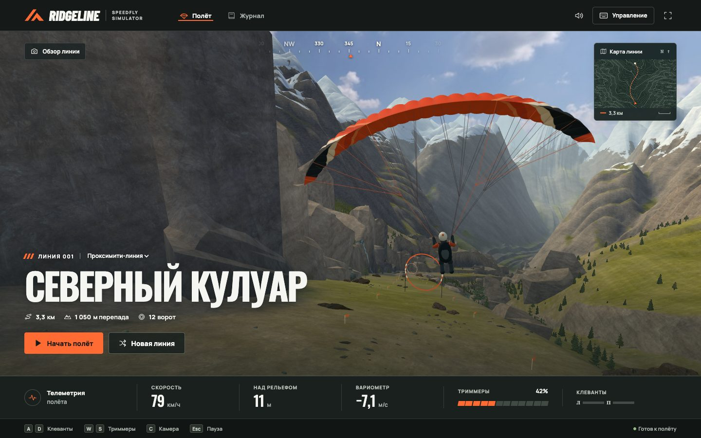

# Ridgeline · Speedfly Simulator

Браузерная 3D-игра о спидфлаинге. Выбери альпийскую линию, подстрой триммеры под уклон и проведи крыло через 12 ворот. Для спиралей и бочек есть свободный полёт со стартом в 350 м над рельефом.

**[Играть в браузере](https://castellord.github.io/SpeedFly/)**



## Первый полёт

Нажми **«Начать полёт»**. Полёт начинается из подвески в 11 м над землёй. Крыло уже направлено к первым воротам, начальный трим подобран под уклон. Короткими нажатиями клевант поправляй курс. Высотомер показывает запас до склона прямо под пилотом, вариометр — вертикальную скорость.

| Управление | Действие в игре |
| --- | --- |
| A / D или ← / → | Левая / правая клеванта. Удерживай для развития крена и разворота |
| A + D или пробел | Симметрично затянуть обе клеванты |
| W / S или ↑ / ↓ | Плавно открыть / закрыть триммеры. Короткие нажатия дают небольшие поправки |
| C | Камера за пилотом / вид из подвески |
| Esc / P | Пауза |
| ? | Справка по управлению |

На телефоне используй экранные клеванты и кнопки T− / T+. Кнопка динамика управляет шумом потока. На разгоне усиливается свист строп, а у поверхности меняется звук обдува. В журнале этого браузера хранятся результаты последних 40 полётов.

## Линии и манёвры

**«Новая линия»** генерирует траверс, ущелье или гребень по числовому seed. На пути встречаются скальные ступени, осыпи, русла и группы хвойных деревьев. Центры 12 ворот находятся в 8,2–10,8 м над местным рельефом. Прибор «Ниже 15 м» считает горизонтальную дистанцию в этой зоне. Перепад и длина считаются по сгенерированному маршруту. Контуры на карте, высотомер и столкновения используют ту же поверхность, что и 3D-сцена.

**«Свободный полёт»** выбирается над названием линии. Удержание одной клеванты затягивает нисходящую спираль. В игровой модели для бочки нужно набрать скорость, установить крен и резко переложить управление на противоположную сторону. Потеря энергии и высоты зависит от состояния крыла в момент манёвра.

Касание склона может закончиться мягкой посадкой. Игра учитывает скорость, крен и скорость сближения с поверхностью. У деревьев и валунов есть объём столкновения.

Модель интегрирует движение материальной точки с подъёмной силой, сопротивлением, силой тяжести и инерцией крена. Открытие триммеров увеличивает установившуюся скорость и угол снижения. Одновременная затяжка клевант на скорости даёт краткое выравнивание, а длительная глубокая затяжка гасит скорость. Скорости, аэродинамические коэффициенты и акробатика настроены для игры. У реального крыла есть собственные ограничения по режимам полёта.

[Разбор шести источников и полётных кадров Джейми Ли с таймкодами](docs/flight-model.md)

## Локальный запуск

Требуются Node.js 24, npm и браузер с WebGL 2.

```sh
npm ci
npm run dev
```

Команда `npm test` проверяет физику и прохождение низких линий. Команда `npm run build` собирает статическую версию в `dist/`. Команда `npm run preview` запускает её локально. Из ветки `main` GitHub Actions собирает и публикует игру на GitHub Pages.

## Графика и материалы

Купол из 27 ячеек, деформация задней кромки, каскады строп, пилот, рельеф и растительность построены процедурно. Сцену рисует Three.js. Статические ресурсы поставляются вместе с игрой.

- Панорама неба — Greg Zaal и Jarod Guest, CC0. [Kloofendal 48d Partly Cloudy (Pure Sky)](https://polyhaven.com/a/kloofendal_48d_partly_cloudy_puresky)
- Текстура высокогорного грунта — Rob Tuytel, CC0. [Aerial Grass Rock](https://polyhaven.com/a/aerial_grass_rock)
- Текстура скал — Dario Barresi и Rico Cilliers, CC0. [Rock Face 03](https://polyhaven.com/a/rock_face_03)
- Фотограмметрические модели валунов — Rico Cilliers и Jenelle van Heerden, CC0. [Boulder 01](https://polyhaven.com/a/boulder_01) · [Rock 09](https://polyhaven.com/a/rock_09)
- Шрифты Manrope, Oswald и Barlow Condensed распространяются по SIL Open Font License. Копии лицензий находятся в `public/assets/fonts/`.
