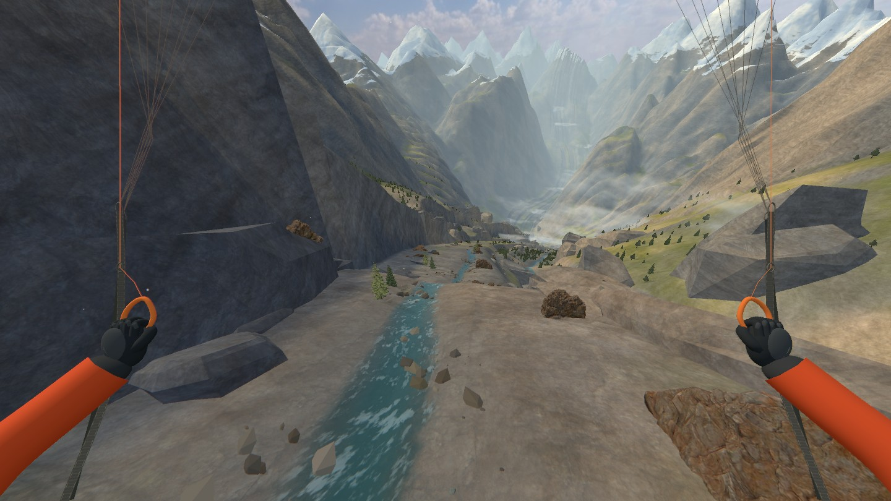
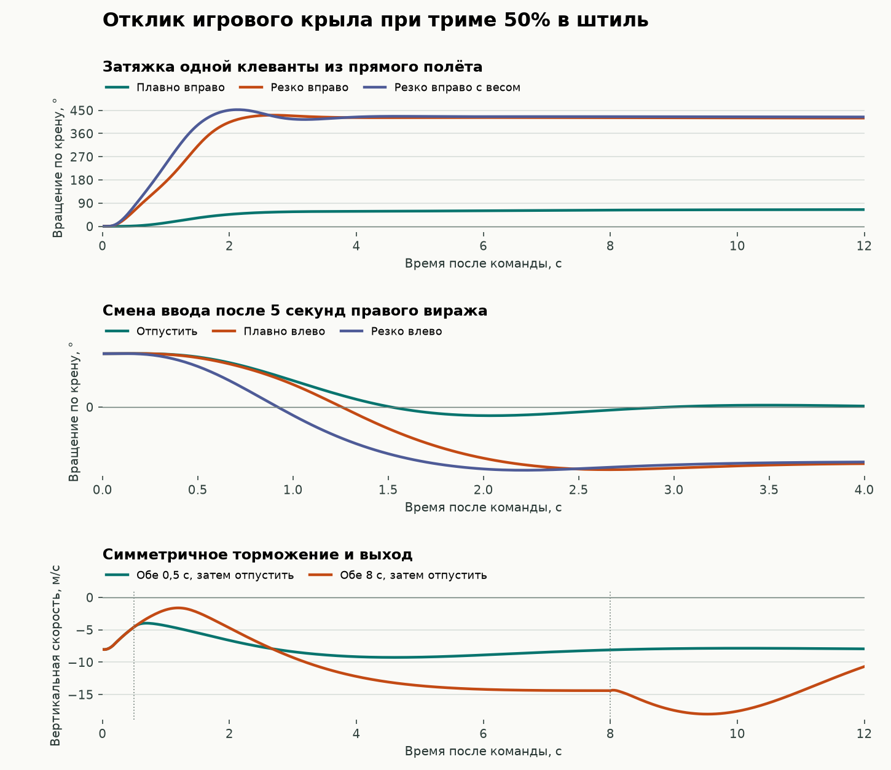

# Как устроен полёт в Ridgeline

В игре моделируется малое спидфлай-крыло с фиксированной загрузкой в спокойном воздухе. Руководства производителей помогли выбрать, как связать управление, скорость, крен и снижение. Видео использовались для формы линии, камеры и ощущения масштаба. Численные коэффициенты подобраны для игры. Высота, скорость и перегрузка Джейми Ли по кадрам не измерялись.

## Что взято из описаний и руководств

| Источник | Наблюдение | Как это работает в игре |
| --- | --- | --- |
| [Ozone, руководство Rapido 3, раздел Trimmers](https://cdn1.flyozone.com/wp-content/uploads/sites/3/2018/09/Rapido-3-manual-EN-v1.0.pdf) | Положение триммеров меняет скорость и угол планирования. | При открытии триммеров крыло постепенно разгоняется и переходит на более крутую траекторию. |
| [Level Wings, Flame](https://archive.levelwings.com/speedwing_miniwing_flame_eng/) | Диапазон триммеров позволяет менять характер полёта от более пологого планирования до крутого снижения. | У каждого промежуточного положения свой установившийся режим. В начале линии игра подбирает трим по уклону первого участка. После старта высоту определяет пилот. |
| [Niviuk, руководство Roller 2](https://niviuk.com/biblioteca/items/1582_A/user_manual_roller_2_glider_niviuk.pdf) | Управление разворотом и выход из крутого снижения зависят от накопленной скорости. | Затяжка одной клеванты развивает крен. На большом крене вертикальная составляющая подъёмной силы уменьшается, а скорость на снижении растёт. |
| [Swing, Mirage 2 RS](https://www.swing.de/produkte/mirage-2-rs/) | Производитель отдельно описывает прогрессивный ход клевант и переход из пикирования в длинный выход. | Общая затяжка меняет подъёмную силу и сопротивление. На скорости возможен краткий набор, после долгой глубокой затяжки падает скорость. |
| [Ozone, Rapido 3X](https://flyozone.com/speed/products/gliders/rapido-3x) | Геометрия подвески и длина строп влияют на характер реакции по крену. | У купола и подвески различается фаза наклона. При перекладке результат зависит от уже накопленной угловой скорости и момента отпускания клеванты. |
| [NZHGPA, техническое руководство TM02, стр. 10–12](https://nzhgpa.org.nz/wp-content/uploads/2022/04/TM02.pdf) | Для выхода из разогнанного поворота нужны время и высота. Накопленная энергия может перейти в более пологий полёт. | После отпускания клеванты крен затухает, а направление скорости выравнивается постепенно. Близость склона проверяется отдельно для тела, центра купола и его концов. |

## Что видно в полётных кадрах

Для двух выпусков GoPro просмотрены кадры с шагом в две секунды. Указанные интервалы помогают найти участок в оригинале.

| Видео | Участок | Решение для игры |
| --- | --- | --- |
| [GoPro, Epic Lines with Jamie Lee — Line 1](https://www.youtube.com/watch?v=Mc6VabRenn0) | 00:50–01:06. Серые плиты быстро проходят внизу, дальняя граница леса смещается гораздо медленнее. Впереди появляются отдельные группы деревьев. | Плиты, осыпь и деревья разного размера дают ориентиры в ближнем плане. В камере из подвески видна поверхность прямо впереди пилота. |
| [GoPro, Epic Lines with Jamie Lee — Line 4](https://www.youtube.com/watch?v=zRdZ2O2m_i0) | 00:54–01:10. Между расколотыми плитами видна белая вода, дальше открывается светлая осыпь. | В долине каменистое русло пересекает линию. Скальная ступень меняет просвет прямо под пилотом, пока крыло продолжает прежнюю траекторию. |
| [Джейми Ли, долина Ахурири, видео Blick](https://www.blick.ch/video/aktuell/speedflyer-jamie-lee-fliegt-mit-160-kmh-durch-das-ahuriri-tal/bcp1w2r) | 00:30–00:48. Кромки сухих скал и пучки травы проходят близко, за перегибом открывается глубокая долина. | За краями полок открывается нижний склон. Расстояние до каждой группы валунов читается по тому, насколько быстро она смещается относительно дальнего склона. |
| [Швейцарская школа спидфлаинга, полёты на снегу](https://speedflyingschool.com/wp-content/uploads/2020/12/Ohne-Logo.mp4) | На внешних планах видно, как при изменении просвета смещается тень. | Тень крыла проецируется по направлению солнца на локальную поверхность рельефа. |

## Спираль и бочка

В спирали траектория обвивает вертикальную ось. При установившемся крене купол остаётся сбоку и выше пилота, а курс продолжает изменяться. В игре виток засчитывается за 360° изменения курса в одном направлении при устойчивом крене и снижении.

При бочке пилот проходит над куполом и снова оказывается под ним. На выравнивании разогнанного крыла возрастают нагрузка и реакция на перенос веса. Та же перекладка после потери скорости может дать лишь качание. В игре проверяются инверсия и возвращение почти в вертикальное положение через другую сторону. [Pro Speedflying, разбор стадий бочки](https://www.prospeedflying.com/speedflying-school/barrel-rolls/) · [NZHGPA TM02, стр. 11](https://nzhgpa.org.nz/wp-content/uploads/2022/04/TM02.pdf)

Для игры выбрано отзывчивое крыло. Niviuk описывает быструю реакцию Roller на клеванты и перенос веса и отмечает влияние размера и загрузки. По наблюдениям швейцарской Speedflying School, у сильно загруженного Flare Line перенос веса может сам по себе вызвать бочку. Эти описания относятся к разным крыльям. Ни одно из них не задаёт универсальных значений времени хода руки или потери высоты. [Руководство Niviuk Roller, § 1.3](https://niviuk.com/biblioteca/items/333_A/MANUAL_ROLLER_ENG_2.pdf) · [Наблюдения школы о Flare Line](https://speedflyingschool.com/product/flareline/)

В симуляторе полный плавный ход занимает около 0,87 с, резкий — 0,17 с. Установившееся натяжение поддерживает крен. Быстрое изменение нагрузки на одной стороне и перенос веса дают кратковременный вращающий момент. При полностью выбранной плавной клеванте переход на резкую клавишу означает краткий дополнительный дожим. Степень отклонения задней кромки остаётся ограниченной. Действие дожима зависит от текущих скоростей разворота по курсу и вращения вокруг продольной оси. В установившейся спирали он увеличивает нагрузку на дуге и уменьшает её радиус. При переходе на плавную клеванту над куполом сохраняется угловая скорость бочки, а дальнейший наклон траектории зависит от оставшейся скорости и подъёмной силы. При вращении часть поступательной энергии расходуется на раскрутку и сопротивление крыла.

При триме 50% горизонтальный радиус установившейся спирали в игре составляет около 23 м. Если на девятой секунде плавного входа резко дожать ту же клеванту и перенести вес внутрь, в следующую секунду радиус уменьшается примерно с 24 до 16 м. Радиус рассчитан как отношение горизонтальной скорости к угловой скорости изменения курса.

| Видео | Наблюдение |
| --- | --- |
| [Learning to Barrel Roll — Speedflying, 00:27–00:35](https://www.youtube.com/watch?v=mYvtwdo3-0c&t=27s) | В последовательности кадров с шагом в секунду линия горизонта уходит вбок, стропы проходят на фоне неба, затем в кадр возвращается склон. По этим кадрам можно сравнивать ориентацию и выход, но точная скорость рук и потеря воздушной скорости неизвестны. |
| [Pro Speedflying, около 06:55–07:15](https://www.youtube.com/watch?v=fno_yAh9OJo&t=415s) | На съёмке напротив пилота земля оказывается над куполом. Это ориентир для проверки инверсии. Последовательность управляющих воздействий разобрана школой в письменном комментарии. |
| [Corsin Walker, 01:20–01:38](https://www.youtube.com/watch?v=Qg2KGtfdbYs&t=80s) | Видны наклон снежного горизонта, уход крыла вбок и возвращение склона в поле зрения. Кадры с шагом две секунды позволяют сравнить ориентацию в отдельных точках. |
| [Джейми Ли, Ахурири, 01:05–01:17](https://www.blick.ch/video/aktuell/speedflyer-jamie-lee-fliegt-mit-160-kmh-durch-das-ahuriri-tal/bcp1w2r) | При просмотре с шагом 0,25 с видно, как меняется положение русла и борта долины при выходе из крена. Сам по себе наклон горизонта в кадре недостаточен для определения бочки. |
| [Théo de Blic / NOVA, Steep Spiral](https://www.youtube.com/watch?v=iVKZE8Np_v8) | При сохраняющемся наклоне подвески за пилотом поворачивается склон. Для сравнения геометрии спирали взята съёмка параплана ION 6. Его скорости и времена не использовались для настройки спидфлай-крыла. |

В модели асимметрия купола и движение подвески имеют разную инерцию. Для оценки нагрузки используются подъёмная сила относительно веса и избыток нормального ускорения на выравнивании. Разгон вращения расходует часть кинетической энергии. Положение подвески рассчитывается с учётом её смещения относительно траектории всей системы.

## Расчёт реакции на клеванты

Скорость обтекания внутренней и наружной половин в повороте различается. Для каждой половины игра рассчитывает местный скоростной напор, изменение подъёмной силы и сопротивления от клеванты и степень отрыва потока. Разность сопротивлений разворачивает купол. Боковая составляющая подъёмной силы искривляет траекторию пилота. Сразу после перекладки нос купола и направление движения могут расходиться. Вклад крена и рыскания зависит от геометрии крыла. [Slegers & Costello, Aspects of Control for a Parafoil and Payload System](https://digitalcommons.georgefox.edu/mece_fac/3/)

Скоростной напор пропорционален квадрату воздушной скорости. Вдоль траектории крыло ускоряет составляющая силы тяжести и замедляет сопротивление. Направление подъёмной силы меняется с наклоном купола. Подвеска обладает инерцией по крену и тангажу. При симметричной затяжке сначала растут кривизна профиля, подъёмная сила и сопротивление. При глубоком удержании и падении скорости развивается отрыв потока. Обтекание восстанавливается за конечное время, поэтому после отпускания некоторое время ещё может расти скорость снижения. Физика выполняет шаг каждые 1/240 секунды игрового времени. [Измерения влияния тормозов и угла установки парафойла](https://guidedparafoils.org/wp-content/uploads/2019/10/1.c032029.pdf) · [Niviuk Roller 2, разделы 4.1 и 5.3](https://niviuk.com/biblioteca/items/1582_A/user_manual_roller_2_glider_niviuk.pdf)

На съёмке выхода из спирали видно, как подвеска продолжает двигаться после смены положения рук. Ролик снят на параплане. Для игры он служит ориентиром по последовательности фаз. [Сравнение выходов, с 01:30](https://www.youtube.com/watch?v=3esr7C_zm4M&t=90s)

На графиках угол крена накапливается: 420° означают бочку и ещё 60° крена. Для перекладок ноль времени соответствует отпусканию правой клеванты. Отрицательная вертикальная скорость означает снижение.

### Результаты 16 сценариев

Все полёты начинаются в штиль на высоте 2000 м над ровной площадкой со скоростью около 82 км/ч и тримом 50%. Вес пилота по центру, кроме отдельно указанной строки. Перед перекладками пилот пять секунд держит первую клеванту. В строках со стрелкой время и потеря высоты отсчитываются с начала второго действия. Отрицательное изменение курса означает суммарный поворот траектории влево. Для повторения расчёта выполни `node scripts/maneuvers.mjs`.

| Действие | Время, с | Потеря высоты, м | Скорость в конце, км/ч | Изменение курса, ° | Бочки |
| --- | ---: | ---: | ---: | ---: | ---: |
| Без клевант | 8 | 64,3 | 82 | 0 | 0 |
| Плавно вправо, держать | 12 | 147,9 | 90 | 440 | 0 |
| Резко вправо, держать | 12 | 160,5 | 79 | 508 | 1 |
| Резко вправо с весом | 12 | 171,8 | 82 | 566 | 1 |
| Плавно вправо → отпустить | 5 | 54,1 | 84 | 28 | 0 |
| Резко вправо → отпустить | 5 | 57,6 | 85 | 33 | 0 |
| Плавно вправо → резко влево | 4 | 48,8 | 80 | -103 | 0 |
| Плавно вправо → плавно влево | 4 | 49,7 | 85 | -69 | 0 |
| Резко вправо → резко влево | 4 | 54,6 | 82 | -111 | 0 |
| Резко вправо → плавно влево | 4 | 55,5 | 88 | -75 | 0 |
| Обе плавно, держать | 8 | 78,6 | 62 | 0 | 0 |
| Обе резко, держать | 8 | 81,2 | 62 | 0 | 0 |
| Обе резко 0,5 с → отпустить | 1 | 4,5 | 73 | 0 | 0 |
| Обе резко 8 с → отпустить | 1 | 15,9 | 75 | 0 | 0 |
| Обе резко 8 с → восстановление | 6 | 78,8 | 86 | 0 | 0 |
| Плавно вправо → обе резко | 3 | 23,9 | 54 | 50 | 0 |

После пяти секунд плавного правого виража резкая левая клеванта за четыре секунды изменила курс примерно на 103° влево, плавная левая — на 69°. При симметричном торможении из того же виража траектория сначала продолжила поворот вправо.

## Границы и проверка модели

Физика интегрирует скорость и направление движения под действием тяжести, подъёмной силы и сопротивления. Крен рассчитывается отдельно как движение подвешенной системы с инерцией и затуханием. Такой подход позволяет прервать вращение и потерять высоту на выходе. Деформация ткани, индивидуальная загрузка, сложения и турбулентность в этой версии не моделируются.

Команда `npm test` проверяет режимы триммеров, размен скорости на высоту, прерванное и завершённое вращение, удар купола и подсчёт дистанции ниже 15 м. Для проверки маршрутов программный пилот раз в 0,2 секунды выбирает обычные дискретные управляющие воздействия. Физика и столкновения работают так же, как при ручном полёте. Тест измеряет проходимость игровой линии, а не соответствие траектории конкретному серийному крылу.

Стартовая линия (seed 1847) пройдена в браузере на полностью открытых триммерах с загруженными моделями валунов. Из 3,28 км горизонтального пути 2,48 км пришлись на высоту до 15 м. Медианный просвет под пилотом составил 13,9 м, минимальный — 8,1 м.
